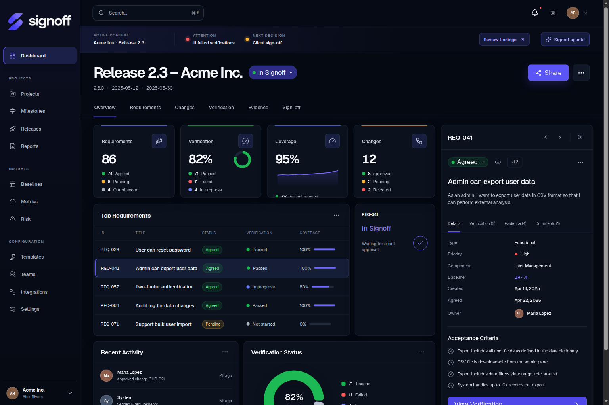
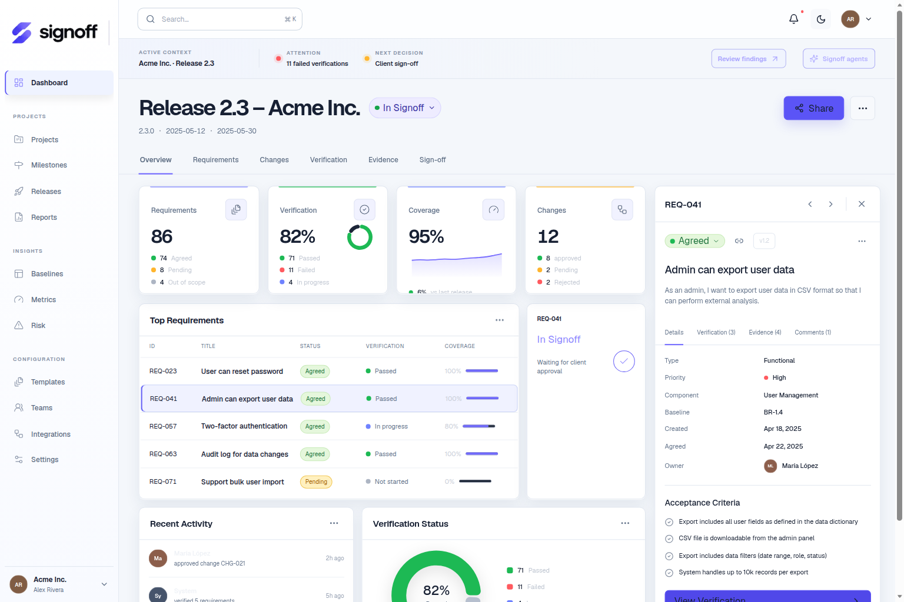
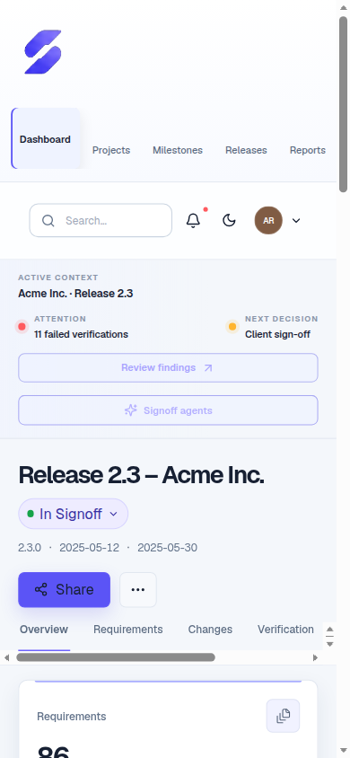
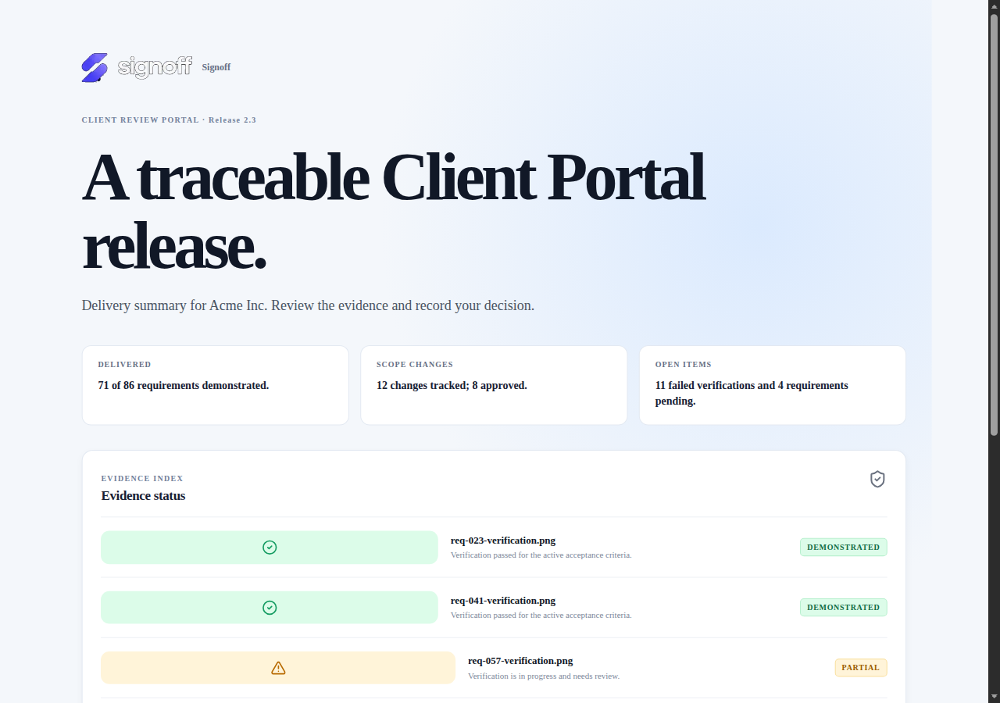
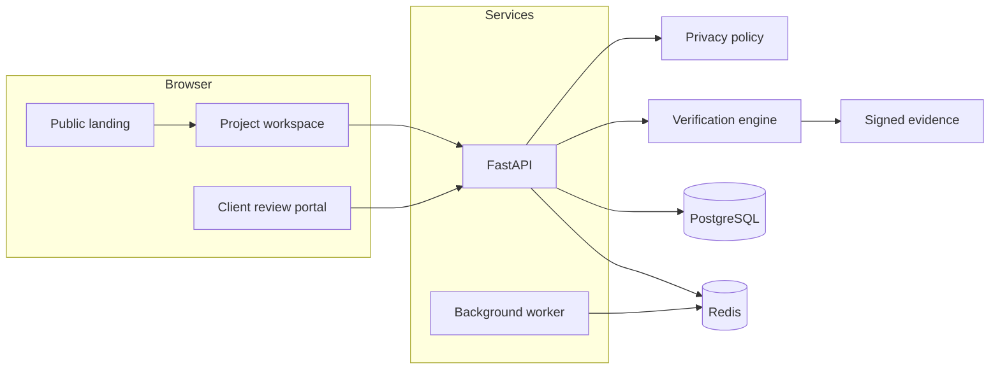
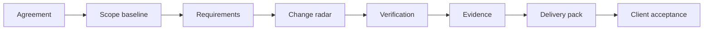

<p align="center">
  <picture>
    <source media="(prefers-color-scheme: dark)" srcset="apps/web/public/brand/signoff-lockup-dark-transparent.png">
    
  </picture>
</p>

<p align="center">
  <a href="https://github.com/diegoperezg7/signoff/actions/workflows/ci.yml"></a>
  <a href="LICENSE"></a>
</p>

<p align="center">Prove what was agreed, what changed, what was delivered and what the client accepted.</p>

Signoff is a browser workspace for software delivery assurance. It keeps the path from an agreement to client acceptance in one trace, without replacing the tracker, the repository or the test suite a team already uses.

## Product

| Step | What you can show |
| --- | --- |
| Agreement | Import a scope document and freeze a baseline. |
| Requirements | Review atomic requirements and draft acceptance criteria. |
| Change | Classify a report as a defect, a scope change or something a person must decide. |
| Verify | Run a bounded check: simulated browser steps, file inspection or human evidence. |
| Evidence | Store hashed artifacts and open them through short-lived signed links. |
| Accept | Send a tokenized review portal and record the client decision. |

The demo ships two synthetic projects on the same workspace: **Acme Inc. / Release 2.3** for the visual sign-off state, and **Customer Operations Portal v1 / Release 1.0** for the functional flow. Nothing in the seed is a real customer.

<p align="center">
  
</p>

<p align="center">
  
</p>

<p align="center">
  
</p>

<p align="center">
  
</p>

## Architecture



Mock mode keeps the catalog in memory and uses a deterministic local model, so the demo and CI need no external keys. Production mode uses the same API with PostgreSQL, a worker, object storage and an allowlisted model provider. See [Architecture](docs/ARCHITECTURE.md) and [AI provider policy](docs/AI_PROVIDER_POLICY.md).

## Delivery flow



A model may draft criteria, a verification plan or a change classification. Those drafts stay unapproved until a person accepts them. Readiness is a delivery signal, not a legal conclusion.

## Quickstart

Docker Compose runs the API, web app, worker, PostgreSQL and Redis. The compose file uses local placeholder credentials only.

```bash
cp .env.example .env
docker compose up --build
```

Open [http://localhost:3000](http://localhost:3000). Choose **Open workspace** for the dashboard. The review portals are `/review/acme-review-token` and `/review/demo-review-token`. The API reference is [http://localhost:8000/docs](http://localhost:8000/docs).

Without Docker, from a machine with Python 3.12 and Node 20:

```bash
python3 -m pip install -r apps/api/requirements.txt
cd apps/api && python3 -m uvicorn app.main:app --port 8000
```

```bash
cd apps/web && npm install && npm run dev
```

## Tests

```bash
make test
make lint
```

`make test` runs the API suite, including the verification engine and the policy, retention and evidence edge cases. The web job in CI builds the Next.js app.

## Governance

- [Data classification](docs/DATA_CLASSIFICATION.md)
- [Data retention](docs/DATA_RETENTION.md)
- [AI provider policy](docs/AI_PROVIDER_POLICY.md)
- [Evidence model](docs/EVIDENCE_MODEL.md)
- [Verification engine](docs/VERIFICATION_ENGINE.md)
- [Security](docs/SECURITY.md)
- [AI architecture](docs/AI_ARCHITECTURE.md) · [Contextual agents](docs/AI_AGENTS.md)
- [Product](docs/PRODUCT.md) · [Roadmap](docs/ROADMAP.md) · [Design system](docs/DESIGN_SYSTEM.md)

Hosted and self-hosted models are selected by provider id (`hosted-a`, `hosted-b`, `self-hosted`). The demo never sends project content to an external model.

## License

[MIT](LICENSE).
