<p align="center">
  <picture>
    <source media="(prefers-color-scheme: dark)" srcset="apps/web/public/brand/signoff-lockup-dark-transparent.png">
    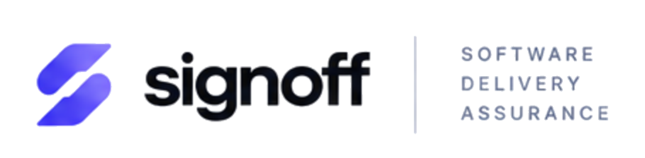
  </picture>
</p>

<p align="center">
  <a href="https://github.com/diegoperezg7/signoff/actions/workflows/ci.yml"></a>
  
  
  
  
  
  
  
  
  <a href="LICENSE"></a>
</p>

<p align="center">Prove what was agreed, what changed, what was delivered and what the client accepted.</p>

Signoff is a browser workspace for software delivery assurance. It keeps the path from an agreement to client acceptance in one trace, without replacing the tracker, the repository or the test suite a team already uses.

<p align="center">
  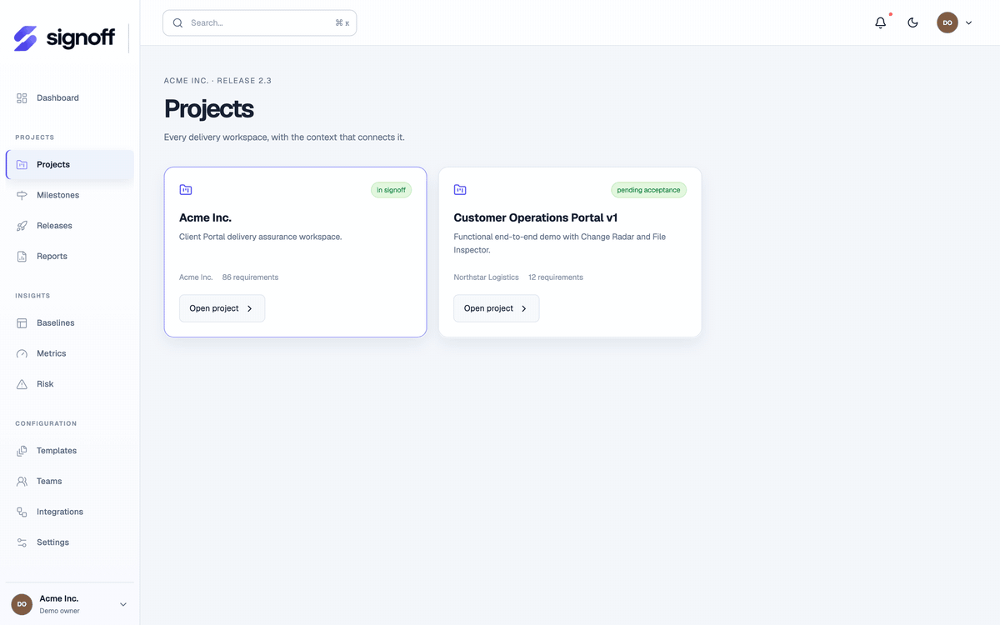
</p>

## Product

| Step | What you can show |
| --- | --- |
| Agreement | Import a scope document and freeze a baseline. |
| Requirements | Review atomic requirements and draft acceptance criteria. |
| Change | Classify a report as a defect, a scope change or something a person must decide. |
| Verify | Run a bounded check: simulated browser steps, file inspection or human evidence. |
| Evidence | Store hashed artifacts and open them through short-lived signed links. |
| Accept | Send a tokenized review portal and record the client decision. |

The demo ships two synthetic projects on the same workspace: **Acme Inc. / Release 2.3**, a client portal release in sign-off with 86 requirements, and **Customer Operations Portal v1 / Release 1.0** for Northstar Logistics, a 12-requirement order operations portal used for the functional flow. Nothing in the seed is a real customer.

## Walkthrough

All screenshots are taken from the app in mock mode, in the order a delivery team would use it.

**1. Projects.** Both demo workspaces, each with its client, release status and requirement count.

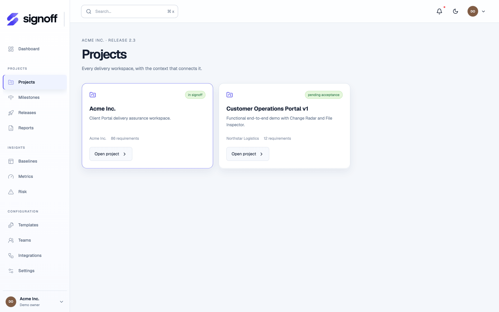

**2. Release overview.** Requirements, verification, coverage and change counts for the active release, with the selected requirement in the side drawer.

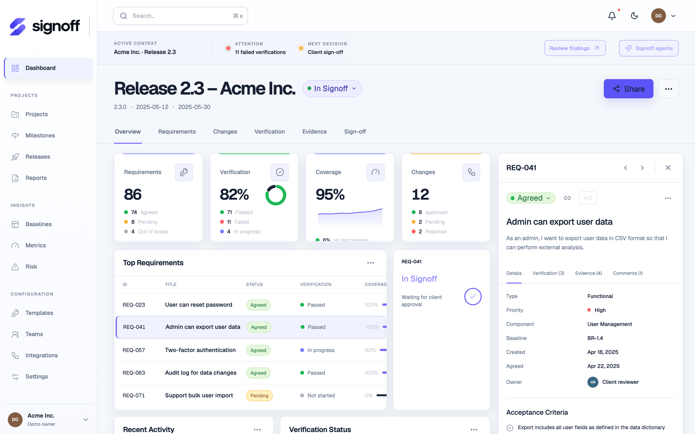

**3. Agreement and scope baseline.** A statement of work is uploaded and extracted into a draft scope version; the approved v1 baseline stays in force until someone confirms the draft.

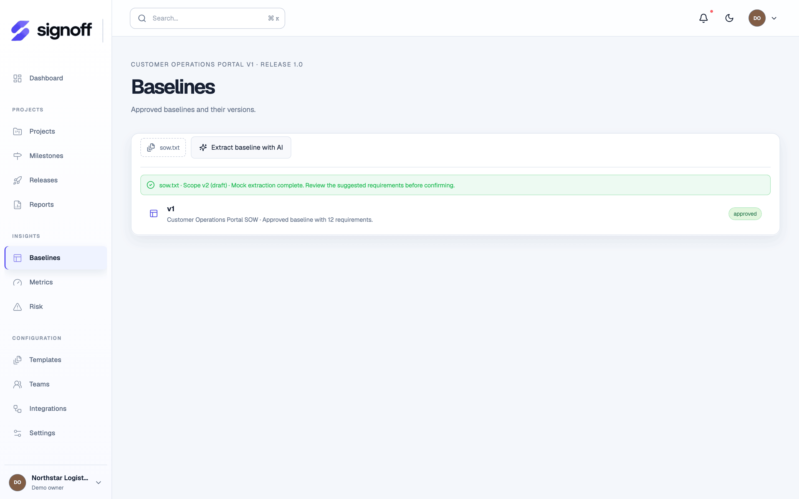

**4. Requirements.** Requirements from the baseline, with type, priority, owner and acceptance criteria. Generated criteria are stored as a proposal, not applied.

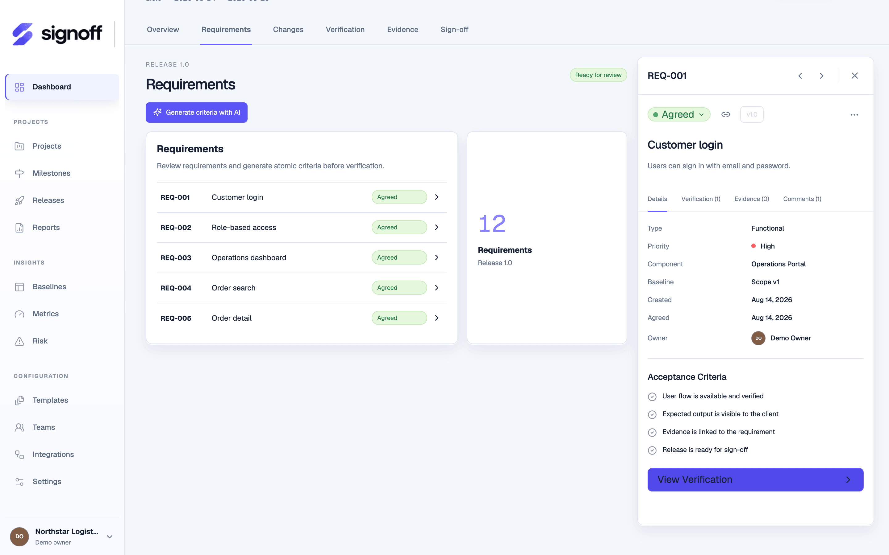

**5. Change Radar.** Incoming change signals are compared with the baseline; a person approves or rejects each one before it enters the release.

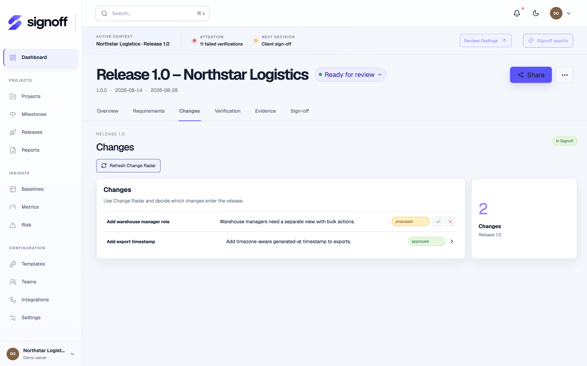

**6. Verification.** A bounded run per requirement reports criteria covered and coverage, and refreshes the linked evidence.

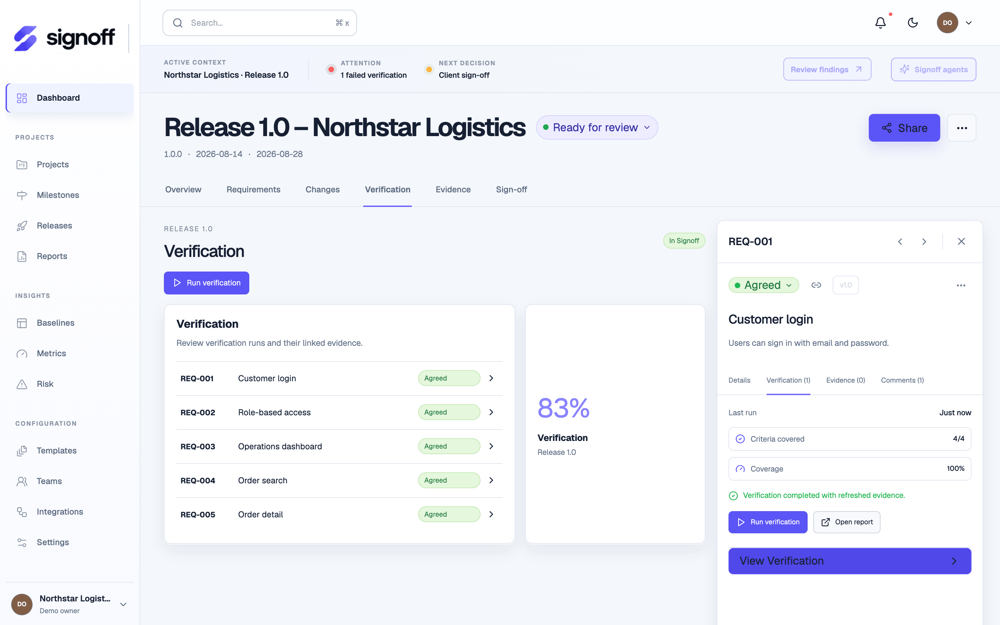

**7. Evidence.** Every artifact is traced to its requirement and opened through a signed, expiring link. The CSV inspector checks columns and row counts.

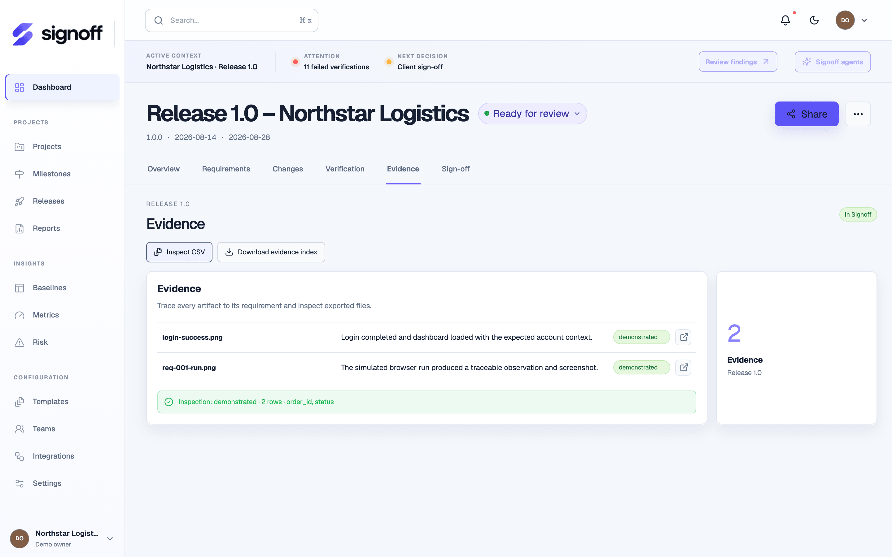

**8. Delivery pack.** Readiness checks run before the pack is sent: assigned requirements, resolved scope changes, criteria, verification coverage and client comments.

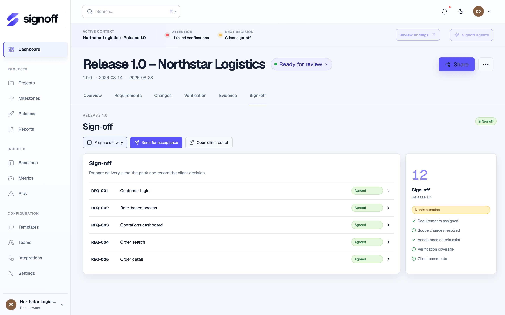

**9. Client review portal.** The client opens a tokenized link with the delivery story and the evidence index. No workspace account is needed.

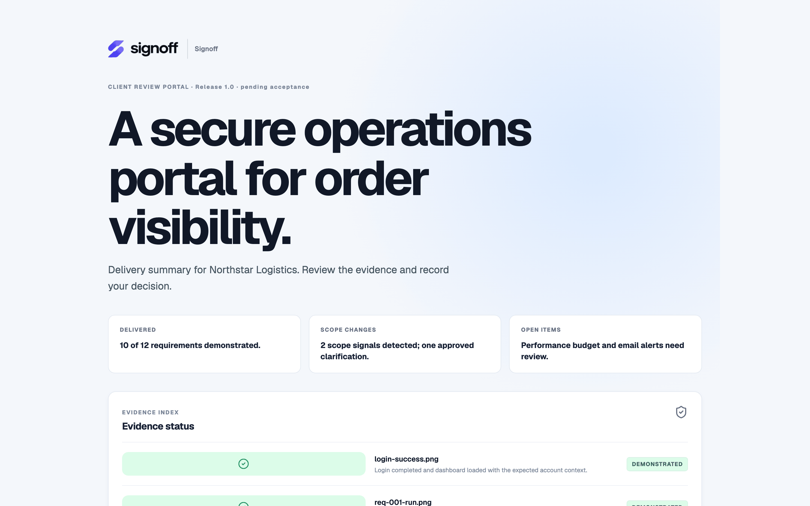

**10. Client acceptance.** The client accepts the delivery or requests a revision; the decision is written to the audit log and updates the release status.

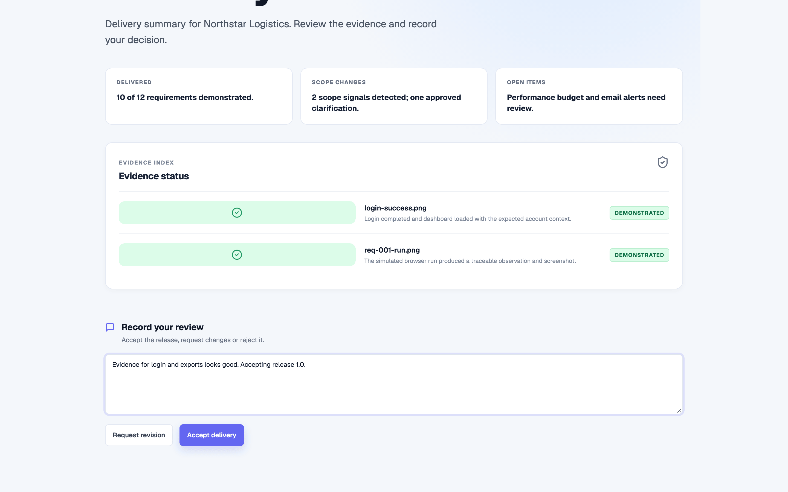

**11. Agent panel.** Eight task-specific agents work inside the active release. Write actions always require approval.

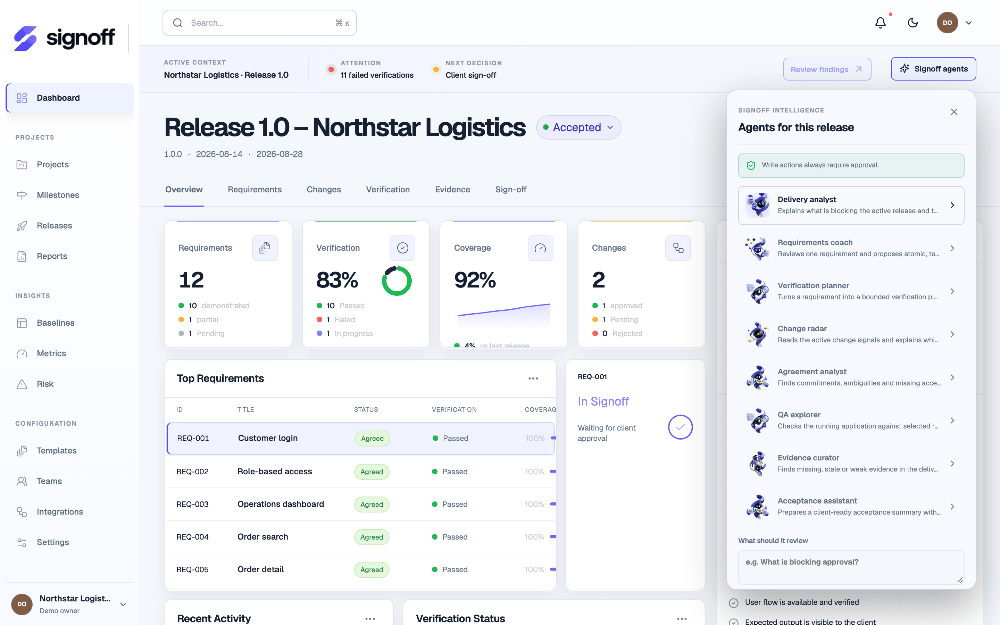

**12. Agent run and pending proposal.** A Requirements coach run shows its trace: run id, checkpoints and each tool call. The drafted criteria wait for a human to approve the proposal.

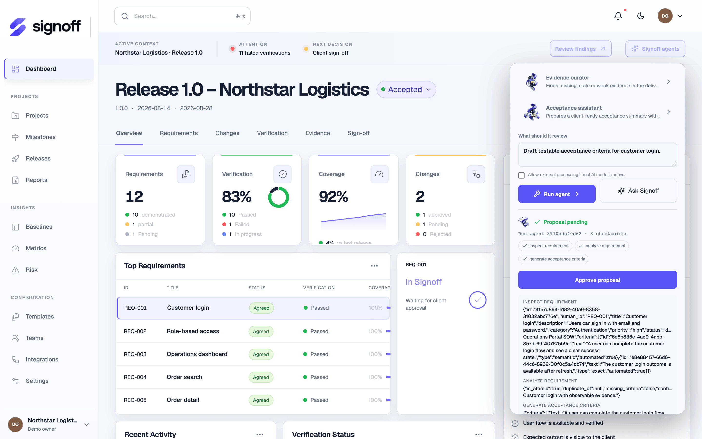

**13. Autonomy policy.** The organization policy read from `GET /api/v1/agent-policy`: allowed risk levels, which ones need approval, blocked tools and step limits.

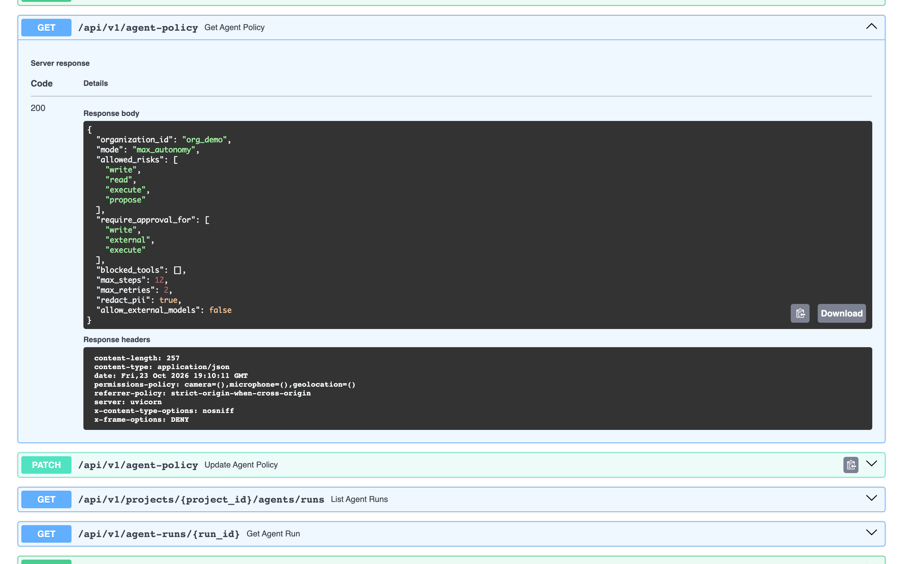

**14. Mobile.** The client review portal on a phone.

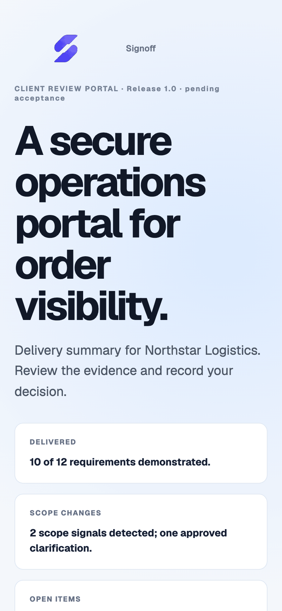

## AI agents

Agents are task-specific operators bound to the active project and release, not a general chat assistant. Each one has a finite plan and an allowlist of tools; the API executes the tools, never the browser or model-generated code.

| | Agent | What it does | Tools |
| --- | --- | --- | --- |
| 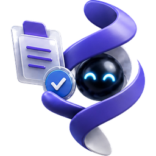 | Delivery analyst | Explains what is blocking the release and the next decision. | `get_delivery_readiness`, `list_attention_items`, `summarize_delivery` |
| 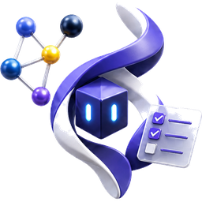 | Requirements coach | Proposes atomic, testable acceptance criteria for one requirement. | `inspect_requirement`, `analyze_requirement`, `generate_acceptance_criteria` |
|  | Verification planner | Turns a requirement into a bounded verification plan. | `inspect_requirement`, `plan_verification` |
|  | Change radar | Explains which change signals need human review. | `list_attention_items`, `classify_change` |
|  | Agreement analyst | Finds commitments, ambiguities and missing criteria in the baseline. | `inspect_scope`, `list_requirements`, `analyze_requirement` |
| 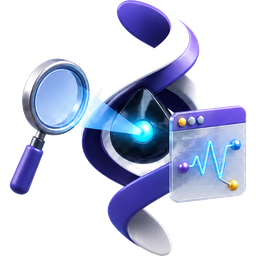 | QA explorer | Checks an allowed running app and stores the observations as evidence. | `inspect_requirement`, `plan_verification`, `discover_routes`, `run_smoke_check` |
| 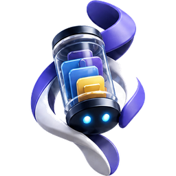 | Evidence curator | Finds missing, stale or weak evidence. | `list_evidence`, `get_delivery_readiness`, `list_attention_items` |
| 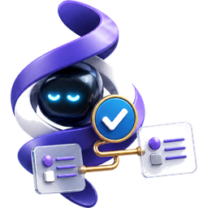 | Acceptance assistant | Prepares a client-ready summary without deciding for the client. | `get_delivery_readiness`, `list_evidence`, `summarize_delivery` |

Every tool in `apps/api/app/agent_runtime.py` declares a risk level (`read`, `propose`, `write`, `execute`, `external`, `critical`). A step runs only if the tool is in the agent allowlist and the organization policy allows its risk. The default policy is `max_autonomy`: read and proposal tools run without interruption, while `write`, `execute` and `external` tools create an approval record. Acceptance decisions are never executed by an agent.

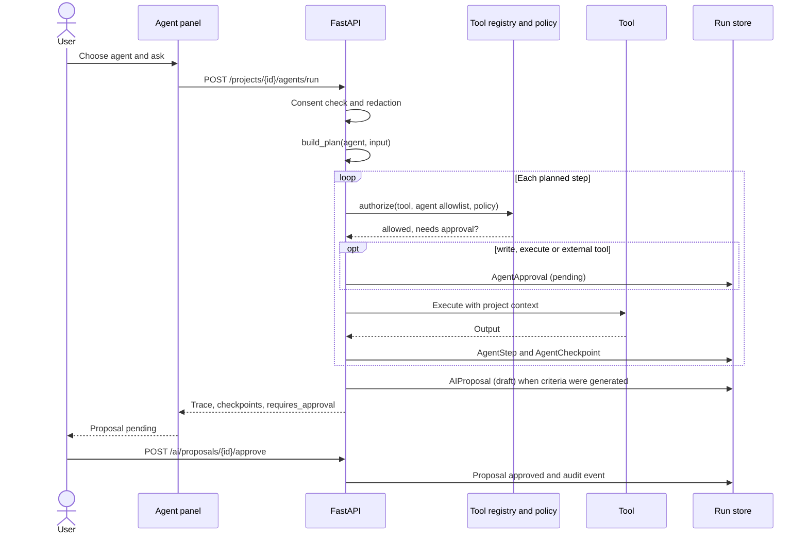

See [Contextual agents](docs/AI_AGENTS.md) and [AI architecture](docs/AI_ARCHITECTURE.md).

## Technical highlights

- **Organization isolation.** Outside mock mode, the user and organization come from a verified Supabase access token (JWKS RS256, or HS256 with the project secret), and the membership table is authoritative for the role. Every route under `/api/v1/projects/{project_id}` resolves the project through the caller's organization before the handler runs, so a project, agent run, approval or AI consent from another organization returns 404, and the PostgreSQL repository filters every project query by `organization_id`.
- **HMAC-signed evidence links.** Evidence is stored with its SHA-256. Local links are signed with HMAC-SHA256 over `key:expiry`, last 15 minutes by default (24 hours at most), are compared in constant time and reject path traversal. In production the S3/R2 adapter issues presigned URLs instead.
- **Data classification and AI consent.** Content is classified on five levels (`PUBLIC` to `RESTRICTED`). An AI call is allowed only for an allowlisted provider, below the configured ceiling for external processing, and with explicit consent for confidential content, recorded per document and model route. Secrets and personal data are redacted before model calls by default. Mock mode never sends content off the machine.
- **Draft-first AI.** Every model output is stored as a proposal with provider, model, prompt version, tokens, latency and estimated cost, and changes nothing until a person approves it.
- **Tests.** 47 API tests (`make test`) cover the verification engine, readiness scoring, the agent runtime and policy, redaction, consent, retention, signed links and the review flow. CI also builds the Next.js app.

## Architecture

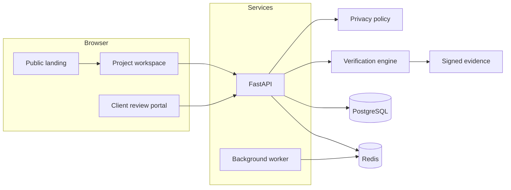

Mock mode keeps the catalog in memory and uses a deterministic local model, so the demo and CI need no external keys. Production mode uses the same API with PostgreSQL, a worker, object storage and an allowlisted model provider. See [Architecture](docs/ARCHITECTURE.md) and [AI provider policy](docs/AI_PROVIDER_POLICY.md).

## Repository layout

```text
signoff/
├── apps/
│   ├── api/                    FastAPI service
│   │   ├── app/
│   │   │   ├── main.py         HTTP routes and the delivery flow
│   │   │   ├── catalog.py      Seeded demo projects and release projections
│   │   │   ├── agents.py       The eight agents and their tool plans
│   │   │   ├── agent_runtime.py  Tool registry, risk levels, policy, runs and checkpoints
│   │   │   ├── providers.py    LLM provider contract, mock and hosted adapters
│   │   │   ├── security.py     Data classification, provider policy and redaction
│   │   │   ├── storage.py      Hashed evidence storage and signed links (local, S3/R2)
│   │   │   ├── auth.py         Token validation and organization membership
│   │   │   ├── domain.py       Readiness scoring and evidence relationships
│   │   │   ├── file_inspector.py  CSV, JSON, TXT and XLSX inspection
│   │   │   ├── qa_explorer.py  Route discovery and smoke checks on allowed hosts
│   │   │   ├── db.py, persistence.py  SQLAlchemy models and PostgreSQL repository
│   │   │   └── jobs.py         Inline job runner for mock mode
│   │   ├── migrations/         Alembic migrations
│   │   └── tests/              pytest suite
│   ├── web/                    Next.js workspace and client review portal
│   │   ├── app/                Routes and stylesheets
│   │   ├── components/         Dashboard, agent panel, providers
│   │   └── public/             Brand assets and agent avatars
│   └── worker/                 Dramatiq actors for Redis deployments
├── docs/                       Architecture, policies and screenshots
├── docker-compose.yml          API, web, worker, PostgreSQL and Redis
└── Makefile                    api, web, up, test, lint, migrate
```

## Project status

Signoff is a proof of concept.

- **Mock mode is the default.** The catalog lives in memory, the model is a deterministic local provider and authentication returns a fixed demo owner. No external keys are needed.
- **Verification is simulated.** Browser runs return scripted steps and evidence; the file inspector and human evidence are real. The QA explorer makes real HTTP requests, only to allowed local hosts.
- **The worker is a stub.** The Dramatiq actors in `apps/worker` record job state transitions but do not run browsers or models yet.
- **Production adapters exist but are not the demo path:** PostgreSQL repository and migrations, Supabase token validation, S3/R2 storage, hosted model adapters and email delivery. A few legacy routes addressed by resource id instead of project (`PATCH /api/v1/requirements/{id}`, `PATCH /api/v1/changes/{id}`, `POST /api/v1/scope/import`) act on the demo project and are not organization-scoped yet.

## Quickstart

Docker Compose runs the API, web app, worker, PostgreSQL and Redis. The compose file uses local placeholder credentials only.

```bash
cp .env.example .env
docker compose up --build
```

Open [http://localhost:3000](http://localhost:3000). Choose **Open workspace** for the dashboard. The review portals are `/review/acme-review-token` and `/review/demo-review-token`. The API reference is [http://localhost:8000/docs](http://localhost:8000/docs).

Without Docker, from a machine with Python 3.12 and Node 20:

```bash
python3 -m pip install -r apps/api/requirements.txt
cd apps/api && python3 -m uvicorn app.main:app --port 8000
```

```bash
cd apps/web && npm install && npm run dev
```

## Tests

```bash
make test
make lint
```

`make test` runs the API suite with the `python3` on your path (override with `make test PYTHON=...`). `make lint` byte-compiles the API and runs ESLint on the web app. The web job in CI builds the Next.js app.

## Governance

- [Data classification](docs/DATA_CLASSIFICATION.md)
- [Data retention](docs/DATA_RETENTION.md)
- [AI provider policy](docs/AI_PROVIDER_POLICY.md)
- [Evidence model](docs/EVIDENCE_MODEL.md)
- [Verification engine](docs/VERIFICATION_ENGINE.md)
- [Security](docs/SECURITY.md)
- [AI architecture](docs/AI_ARCHITECTURE.md) · [Contextual agents](docs/AI_AGENTS.md)
- [Product](docs/PRODUCT.md) · [Roadmap](docs/ROADMAP.md) · [Design system](docs/DESIGN_SYSTEM.md)

Hosted and self-hosted models are selected by provider id (`hosted-a`, `hosted-b`, `self-hosted`). The demo never sends project content to an external model.

## License

Proprietary. Copyright (c) 2026 Diego Pérez. All rights reserved.

See [LICENSE](LICENSE). The source may be viewed for evaluation only. Production use, copying, modification and redistribution require prior written permission.
