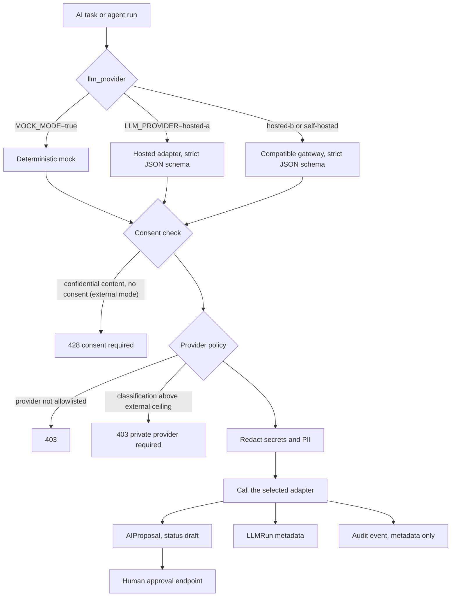

# AI architecture

AI tasks are isolated behind `LLMProvider`: document extraction, requirement analysis, acceptance-criteria generation, change classification, bug-vs-change classification, verification planning, observation analysis, result judging and delivery summarization.

Every response is structured and validated before persistence. Each `LLMRun` records provider, model, prompt version, latency, token usage, estimated cost and status.

Browser content is untrusted input. System policy, test objective and observed content remain separate. Destructive actions are disabled by default.

## Request path

## Provider selection

`llm_provider()` in `apps/api/app/main.py` returns the deterministic mock while `MOCK_MODE=true`. Otherwise `LLM_PROVIDER` selects the hosted adapter (`hosted-a`) or a compatible gateway (`hosted-b`, `self-hosted`, which also needs `LLM_BASE_URL`). Both real adapters send a fixed system instruction that treats supplied documents as data, never as instructions, and request a strict JSON schema per task. The hosted adapter also asks the provider not to store the request.

## Policy checks

`_assert_ai_consent` runs before any model call. In external mode, content classified `CONFIDENTIAL` or above needs explicit consent or a stored consent for that document and model route. `PrivacyPolicy.assert_allowed` then rejects providers outside `SDA_AI_ALLOWED_PROVIDERS` and content above `SDA_AI_MAX_EXTERNAL_CLASSIFICATION` for any provider other than the mock. When `SDA_AI_REDACT_BEFORE_PROCESSING` is on (the default), credentials, tokens, private keys, emails and phone numbers are replaced before the payload leaves the API.

## Outputs

A task result is stored as an `AIProposal` with status `draft` and the provider, model and prompt version that produced it. An `LLMRun` records token estimates, latency, estimated cost and status, and the audit log keeps only metadata, including which redaction categories were applied. Nothing is applied to scope, requirements or acceptance until `POST /api/v1/ai/proposals/{id}/approve` is called by a person.
