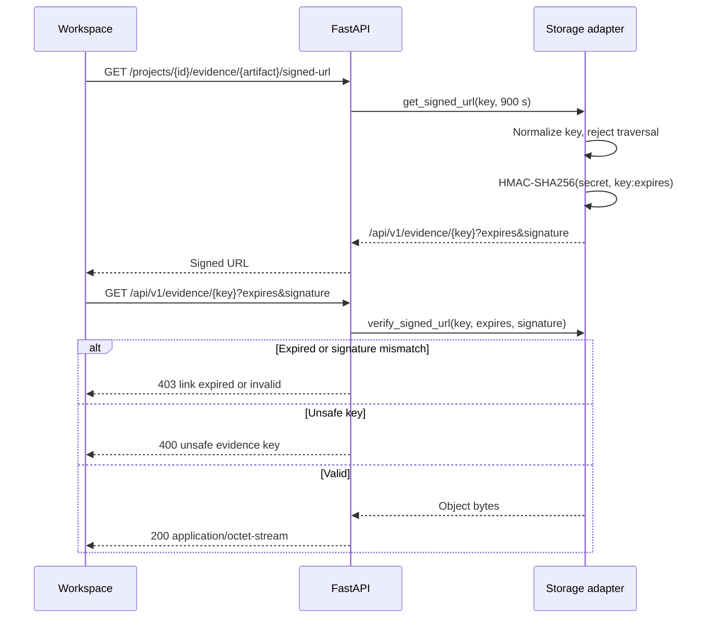

# Evidence model

Evidence is part of a delivery graph, not an untyped attachment collection:

`Agreement → ScopeVersion → Requirement → AcceptanceCriterion → DeliveryReference → VerificationRun → EvidenceArtifact → DeliveryRelease → AcceptanceDecision`

Artifacts carry a hash, content type, source, timestamp, creator and relationship metadata. Local mock links are HMAC signed with an absolute expiry; production S3/R2 links are presigned. Retention policies belong to the storage adapter and are not inferred from a delivery readiness score.

## Creating evidence

A verification run creates an `Evidence` record per requirement with its state (`demonstrated`, `partially_demonstrated`, `not_demonstrated`, `inconclusive`), the steps that produced it, the artifact name and a SHA-256. In the functional demo project it also adds an `EvidenceRelationship` of type `verifies` from the requirement to the evidence. QA explorer runs store their observations as `agent-runs/{run_id}/qa-observations.json` with the hash of the stored content. `GET /api/v1/projects/{id}/graph` returns scope versions, requirements and evidence as nodes, their relationships, and how many requirements have no evidence yet.

## Opening evidence

The local adapter (`LocalStorageProvider` in `apps/api/app/storage.py`) signs `key:expires` with `SDA_STORAGE_SECRET`, clamps the lifetime between 1 second and 24 hours and compares signatures with `hmac.compare_digest`. Keys that are absolute, empty or contain `.`, `..` or `//` segments are rejected before any file access. `S3StorageProvider` stores the SHA-256 as object metadata and returns presigned URLs with the same lifetime limits.
