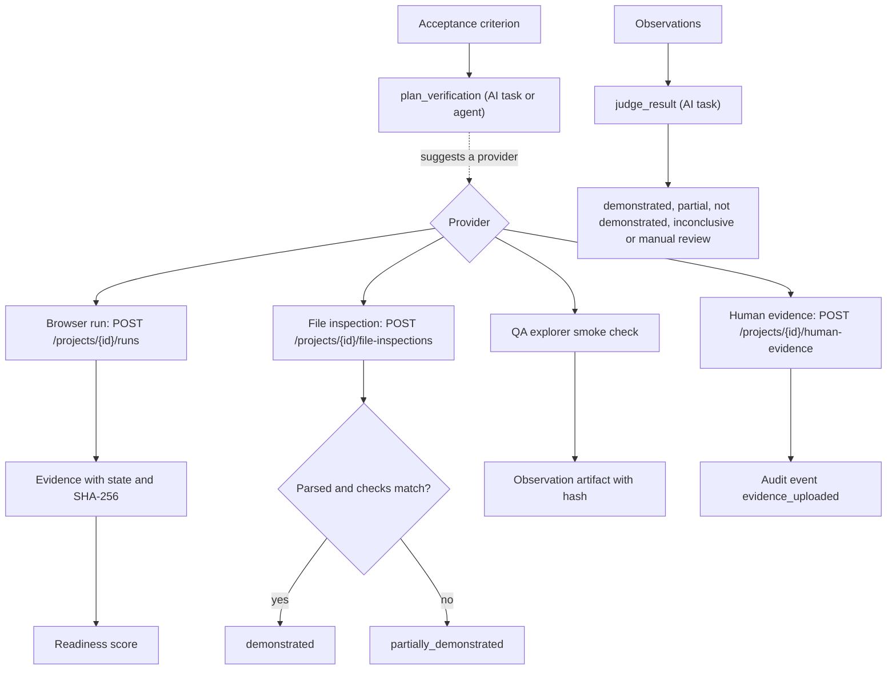

# Verification Engine

The engine verifies acceptance criteria, not arbitrary websites. Providers are designed for Browser Agent, File Inspector, API Verification, existing test ingestion, CI results, database assertions, AI evaluation and human evidence.

The first complete providers are Browser Agent fixtures, deterministic File Inspector parsing and Human Evidence. Browser runs are designed around isolated contexts, allowed domains, step/retry/time limits and structured ResultJudge output. The default worker image runs the queue actors and does not download a browser binary.

## Flow

## Providers in the code

- **Browser run.** `POST /api/v1/projects/{id}/runs` accepts requirement ids or human ids (`REQ-001`) and skips unknown ones. The current implementation simulates the browser: it records the planned steps (isolated context, navigation, criteria, screenshot and DOM snapshot) and returns evidence per requirement; known gaps in the seed stay `not_demonstrated`.
- **File inspector.** `apps/api/app/file_inspector.py` parses CSV, JSON, TXT/MD and XLSX, returns columns, row counts, a sample and the SHA-256, and never raises on bad input: an unparseable file comes back as `valid: false`. The endpoint compares expected columns and row count and marks the result `demonstrated` only when both match.
- **Human evidence.** A person attaches evidence to a requirement; the API checks the requirement exists and writes an audit event.
- **QA explorer.** `apps/api/app/qa_explorer.py` discovers routes and runs smoke checks over HTTP, only on explicitly allowed hosts (`localhost`, `127.0.0.1` by default), bounded by the policy step limit.

## Plan and judgement

`plan_verification` returns one of `BrowserAgent`, `FileInspector`, `APIVerifier` or `HumanEvidence`, the steps and whether a person must confirm. `judge_result` returns `demonstrated`, `partially_demonstrated`, `not_demonstrated`, `inconclusive` or `manual_review_required`, with references to the observations it used; without observations the mock returns `inconclusive`.

## Readiness

`calculate_readiness` in `apps/api/app/domain.py` scores a release as `(demonstrated + 0.5 × partial) / total × 100`, then subtracts a penalty capped at 25 points: 5 per unapproved scope change, 2 per requirement without evidence and 3 per unresolved client comment. The score is clamped to 0–100 and is a delivery signal, not a legal conclusion.
